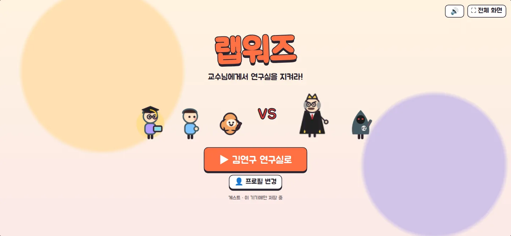
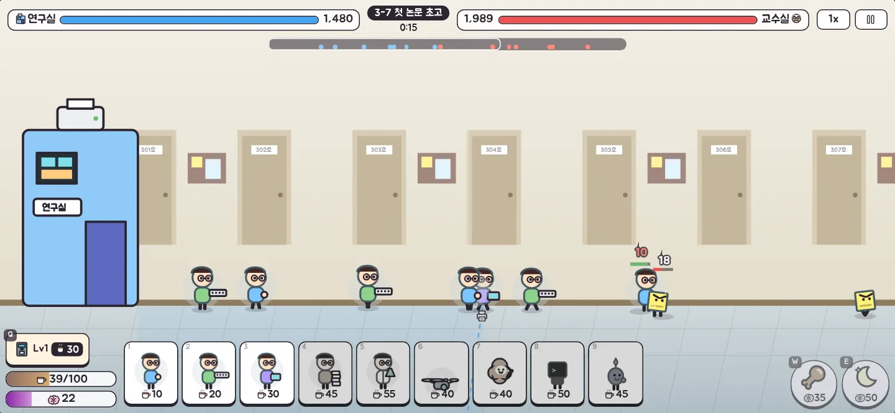
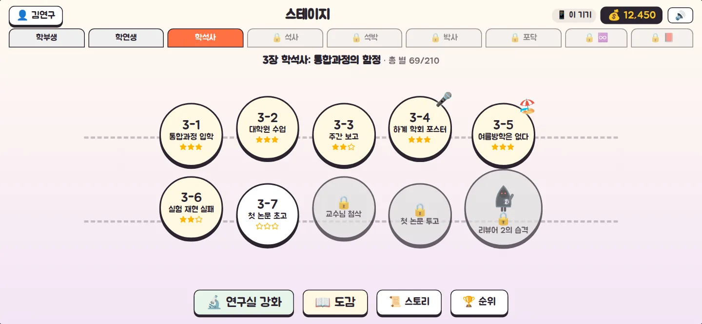
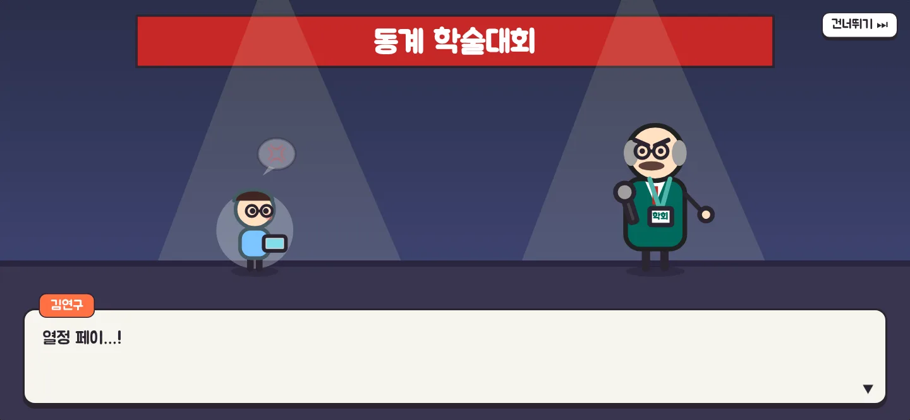
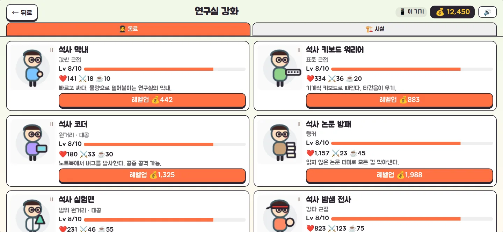
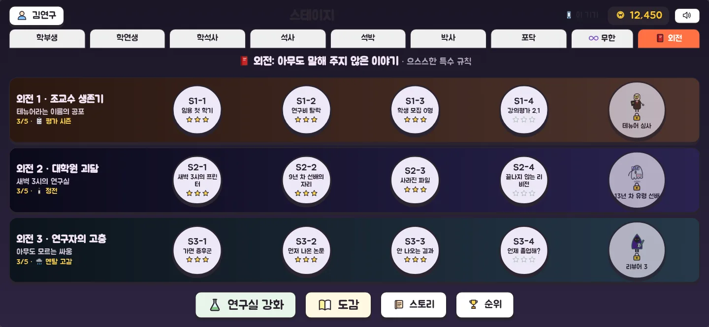
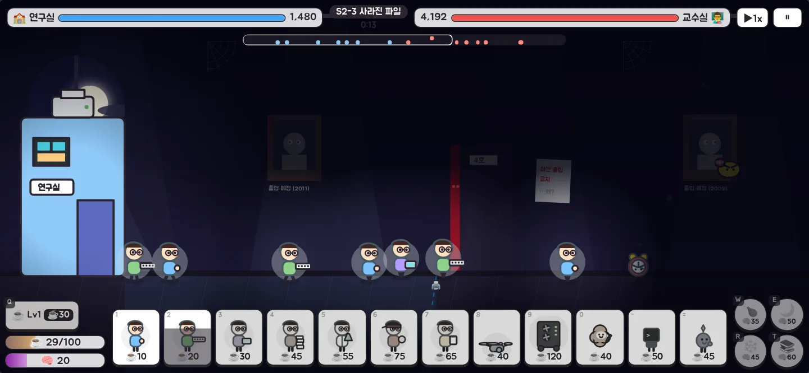
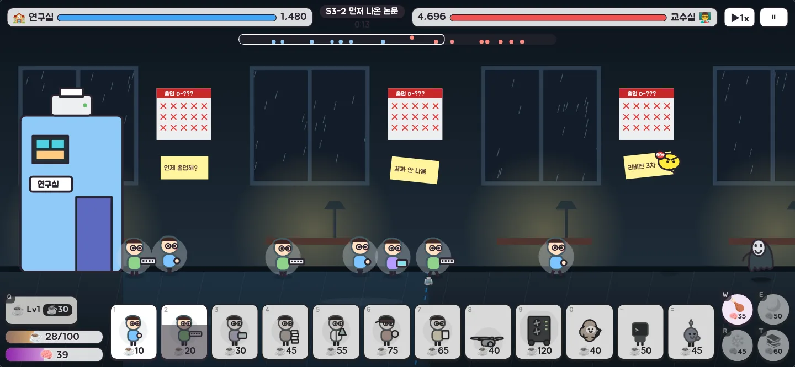

[한국어](README.md) | English

<div align="center">

# 🧪 Lab Wars (랩워즈)

**The lab is about to collapse under the professor's busywork. The grad students are fighting back.**

A side-scrolling lane-defense game you can play anywhere on mobile, in landscape or portrait

[](https://apg0001.github.io/lab-wars/)

[](https://github.com/apg0001/lab-wars/actions/workflows/ci.yml)
[](https://github.com/apg0001/lab-wars/actions/workflows/pages.yml)




</div>

---

## 🎮 What is it?

Brew Caffeine to send out your **labmates**, push back the professor's **army of busywork**, and **storm the Prof's Office**.
Start as an undergrad and survive all the way to postdoc… and in the end, you become a professor yourself. *That* kind of professor.

The game follows your browser language: Korean if it starts with `ko`, English otherwise. You can switch anytime in the settings (한국어 / English).

<p align="center">
  
</p>

| | |
|:-:|:-:|
| <br>**7 chapters, 70 stages** · from undergrad to postdoc | <br>**An animated story cutscene for every stage** |
| <br>**Level up, evolve, upgrade facilities** | <br>**Seven Side Stories after the ending** |

## ✨ Features

### ⚔️ Battle
- **12 ally units + 28 gear units**: lab members who *evolve* from Undergrad → Master's → PhD, a Research Drone (flying), a GPU Server (siege), AI-assistant parody units (Claudy · Codexy · Jaeminai), and ICT & electronics gear that upgrades from Mk.I → Mk.III (14 Rare · 9 Epic · 5 Legendary: Soldering Iron, Tesla Coil, Cell Tower, Quantum Computer, Particle Accelerator…)
- **15 enemies + 10 bosses**: from the Busywork Memo to Reviewer 2, the Committee Chair, and the final boss, the **University President**
- Ground/air targeting rules, splash damage and knockback, Caffeine back on kills, coffee machine upgrades mid-battle
- Auto turrets on both sides, 4 skills powered by Sanity, 1x · 2x · 3x speed
- 📦 **Equipment Grant (unit draws)**: spend tickets on ICT & electronics gear (Rare 70 · Epic 25 · Legendary 5%, Epic+ guaranteed in a 10-draw, pick-a-Legendary spark at 100). Gear brings burn, slow, freeze, pierce, shields, turrets, reboots, chain lightning, armor shred, knock-ups, lifesteal, stun pulses and packet summons into your **9-slot squad**. Duplicates become Passion and raise the level cap
- 🚨 **Prof's Emergency Summons**: push the Prof's Office too hard and it strikes back with shockwaves and reinforcements, so sheer numbers won't cut it
- 💌 **Conference Raffle**: survive a rush and pick one of three envelopes for a card that lasts the rest of the battle (Common, Rare, Legendary, or Cursed)

### 📚 Campaign and story

| Chapter | Rank | Boss |
|:-:|---|---|
| 1 | 🎒 Undergrad: Knocking on the Lab Door | Lab Meeting Prof |
| 2 | 🧑‍🔬 Undergrad Researcher: Intern on Paper, Errand Runner in Practice | PI Prof |
| 3 | 📄 BS/MS Track: The Integrated-Program Trap | **Reviewer 2** |
| 4 | 🎓 Master's: The First Defense | Conference Chair |
| 5 | 📝 MS/PhD Track: Thesis Season | Committee Chair |
| 6 | 🔬 PhD: The Program That Never Ends | Department Head |
| 7 | 💼 Postdoc: On the Brink of Faculty | **University President** |

- **Event stages** like 🏖️ breaks, 🎤 spring/summer/fall/winter conferences, and 📝 thesis season
- Every stage except bosses has a short **story cutscene** (walking, jumping, emote bubbles, voice blips)
- 📜 Story replay: **binge-watch** from any scene, or **resume** where you left off
- 🎓 An unskippable ending, plus an ever-harder **♾️ Endless Mode** you can play from the start, with a **🏆 leaderboard**. As the rounds climb, the **Bug Army** joins in (Segfault · Memory Leak · Infinite Loop · Merge Conflict · Blue Screen · Power Outage), and the Kernel Panic and Legacy Code bosses show up from round 30

### 📕 Side Stories: the parts nobody tells you

| | |
|:-:|:-:|
| <br>**Grad School Ghost Stories**: a blacked-out hallway at 3 AM | <br>**A Researcher's Struggles**: the lab on a rainy night |

| Side Story | Special rule | Boss |
|---|---|---|
| 1 · Assistant Prof Survival Guide | 📋 **Evaluation Season**: enemies periodically get fiercer | Tenure Committee |
| 2 · Grad School Ghost Stories | 🕯️ **Blackout**: you only see around your allies. Ghosts flicker | 13th-Year Ghost Senpai |
| 3 · A Researcher's Struggles | 🌧️ **Sanity Drain**: Sanity keeps dropping; at zero, attack −25% | Reviewer 3 |
| 4 · 24 Hours to Deadline | ⏳ **Countdown**: 4:00 time limit (boss 4:30); enemies keep speeding up to ×1.5 | Submission System (Server Overload freezes everyone) |
| 5 · The Lab in the Age of AI | 🤖 **Generative Copy**: every 14s one of your recent summons is cloned onto the enemy side at 60% stats | Auto-Review AI (silences nearby allies' abilities) |
| 6 · After Graduation: The Lab Startup | 🔥 **Burn Rate**: caffeine charge shrinks over time, down to 35% | VC Partner ("So what's the business model?" flying questions) |
| 7 · Blackout Day | ⚡ **Power Blip**: every 20s allies are stunned 1.5s and each has a 10% chance to vanish. Allies near a UPS are safe | Main Breaker (blips come faster as its HP drops) |

### 🎓 Major Mode: 41 ICE courses

Clear 1-10 to get your **major assigned**. Pick courses on the curriculum map (Years 1–4 × two terms), beat the course's professor (all fictional) in the final, and earn a **grade (A+~F)**. **Each course's core idea is its battle rule**: Data Structures pushes new enemies to the front like a stack (LIFO), Computer Organization rewards cache hits and stalls the enemy pipeline, Algorithms makes the professor hit n² harder, Signals and Systems samples enemies so they flicker in and out of view, and so on.

- C+ or lower can be **retaken** (capped at A0); prerequisites unlock later courses. Pass everything to graduate!
- Your GPA shows on the **leaderboard**.

### 🎨 And also
- 🖌️ **Zero image files**: every character, background, and effect is drawn directly with Canvas
- 🎵 **Zero audio files**: 7 music tracks and all sound effects are synthesized live with Web Audio (separate music/SFX toggles and volume)
- 💥 Impact effects: hit flashes, hitstop, debris, damage numbers
- ☁️ Log in to continue on any device (self-hosted server); guests save on the device
- 📲 Install to home screen (PWA) and play offline
- 💌 **Peer Review cosmetic draws**: submit papers with Funding and get hats, outfit colors and titles stamped Accept, Minor Revision, Major Revision or Reject. Dress the hero and each labmate in the Wardrobe and it shows up in battle, the encyclopedia and cutscenes (stats unchanged)
- 🔄 **Portrait support**: hold your phone upright and the battlefield goes on top with a big grid of deploy buttons below. Rotating mid-battle just keeps going
- 🌐 **Korean / English**: picks your browser language automatically, switchable in the settings

## 🕹️ Controls

| Action | 📱 Mobile | 🖥️ Desktop |
|---|---|---|
| Deploy a unit | Tap the bottom buttons (big button grid in portrait) | Click or `1`–`9` (squad order) |
| Upgrade the coffee machine | ☕ button above the Caffeine bar | `Q` |
| Skills | Bottom-right buttons; above the deploy buttons in portrait (Barrage: button → tap a spot) | `W` `E` `R` `T` (Barrage: key → click a spot) |
| Move the camera | Drag the battlefield, tap the minimap | Drag, wheel, `←` `→` |
| Speed | ▶1x button (1x → 2x → 3x) | Click the button |
| Pause | ⏸ | `Esc` / `P` |
| Advance the story | Tap the screen | Click, `Space` / `Enter` |

## 💡 Tips

- **Flying enemies** (paper planes, notification bombs) can only be hit by ranged units. Always mix in Coders or Drones.
- Kills give Caffeine back. Farm kills with cheap units early, and upgrading the coffee machine (`Q`) early makes life easier.
- Rush the Prof's Office all at once and you'll get swept up in the 🚨 **Emergency Summons**. Catch your breath right before 75%, 50%, and 25% HP.
- Stuck? Replay stages you've already cleared to earn Funding (replays pay 50%).
- 📅 The Planner App shortens redeploy cooldowns; 🧘 the Meditation App speeds up Sanity charging for skills.

## 🛠️ Development

Requires **Node.js 22 or later**.

```bash
npm install
npm run dev        # dev server (reachable from phones on the same network)
npm test           # unit and balance regression tests
npm run typecheck
npm run build      # static build in dist/

# Full campaign + Side Story balance report via the auto-play bot
BALANCE_REPORT=1 npx vitest run tests/balance-report.test.ts --disable-console-intercept
```

- Merging into `main` deploys to GitHub Pages automatically.
- See [docs/server.md](docs/server.md) for running the account server and its API, and [docs/game-design.md](docs/game-design.md) for game numbers and rules (both in Korean).

### Adding text in both languages

- UI strings: `tr('한국어', 'English')` from `src/i18n`, called at render time.
- Data (units, enemies, stages, cards, cosmetics, patch notes…): add an `en: { ... }` field next to the Korean fields; `localizeAll` swaps them in place when the language changes.
- Story: English lines live in `src/story/en/` keyed by scene id, one per Korean line. `tests/i18n.test.ts` checks coverage and `{name}` / `{icon}` token parity.

### Tech stack

| Area | Used |
|---|---|
| Client | TypeScript, Vite, Canvas 2D, Web Audio, DOM HUD |
| Simulation | Fixed-step deterministic simulation (seeded RNG), balance bot |
| Server | Node.js, SQLite, Docker |
| Testing & deploy | Vitest, GitHub Actions, GitHub Pages, PWA |

### Layout

```
src/
  data/      unit, enemy, stage, Side Story, skill and facility numbers (the source of balance)
  sim/       battle simulation decoupled from rendering, progression math, balance bot
  render/    Canvas characters, backgrounds, Side Story themes, effects, impact juice
  audio/     Web Audio synthesized SFX and music
  story/     story scripts (main, per-stage, Side Stories) and the animated cutscene player
  i18n/      language detection, switching, and the tr() helper
  ui/        title, map, lab upgrades, squad, first-battle tutorial, encyclopedia, Peer Review (cosmetics), battle HUD (DOM)
  save/      save store interface, on-device profiles, account server sync
server/      account server (Node + SQLite, Docker)
tests/       Vitest tests
docs/        design doc, server doc, README images
```

## 👤 Author

**[박기찬 (Gichan Park)](https://github.com/apg0001)** (`apg0001`): design, development, balance, and grad-school survival.
Built from firsthand experience with professors' busywork.

## 🤝 Contributing

Issue, branch, commit, and PR conventions are in [CONTRIBUTING.md](CONTRIBUTING.md) (Korean).

<div align="center">
<sub>Dedicated to every professor, and to Reviewer 2. 😇</sub>
</div>
