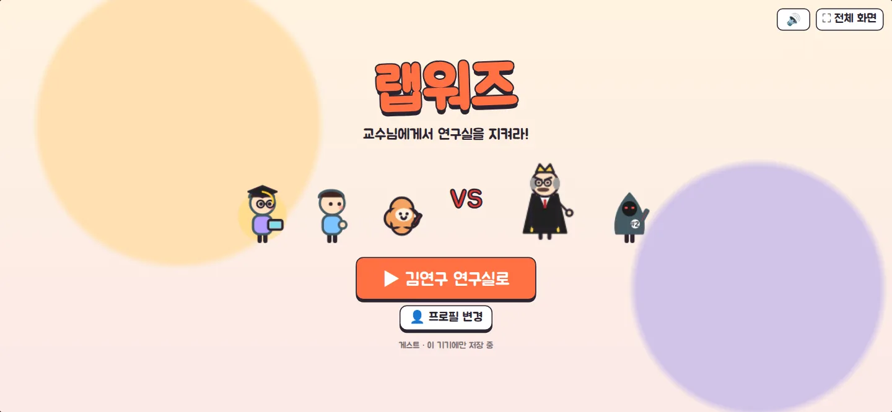
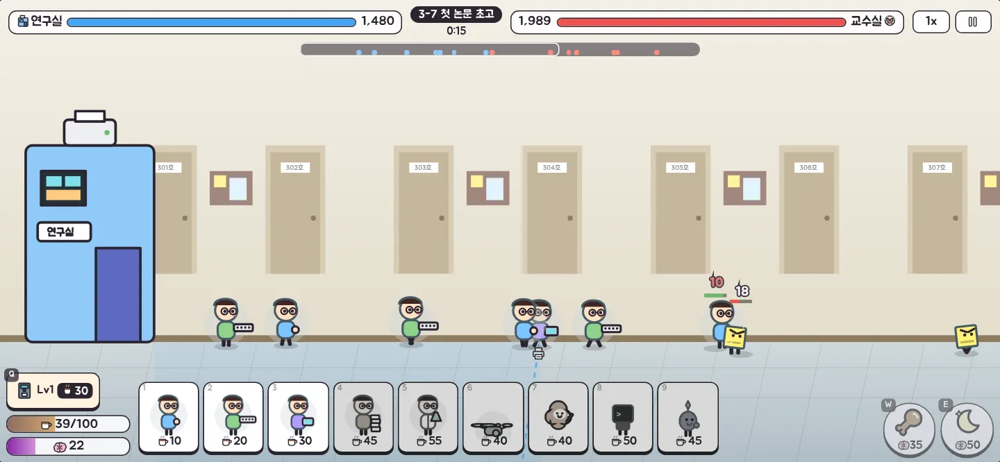
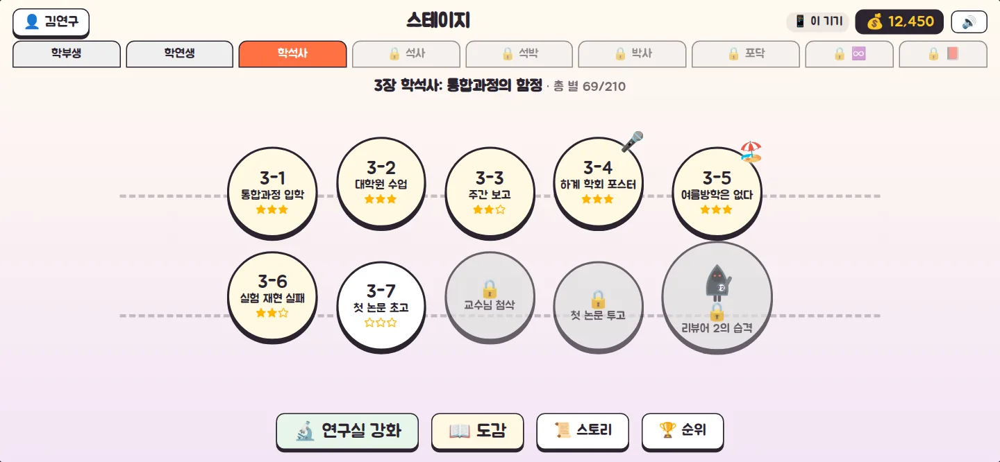
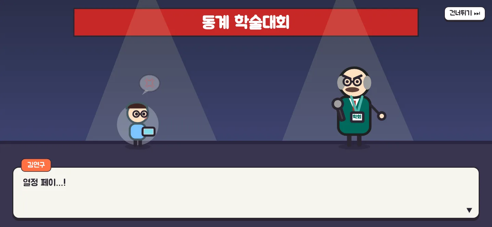
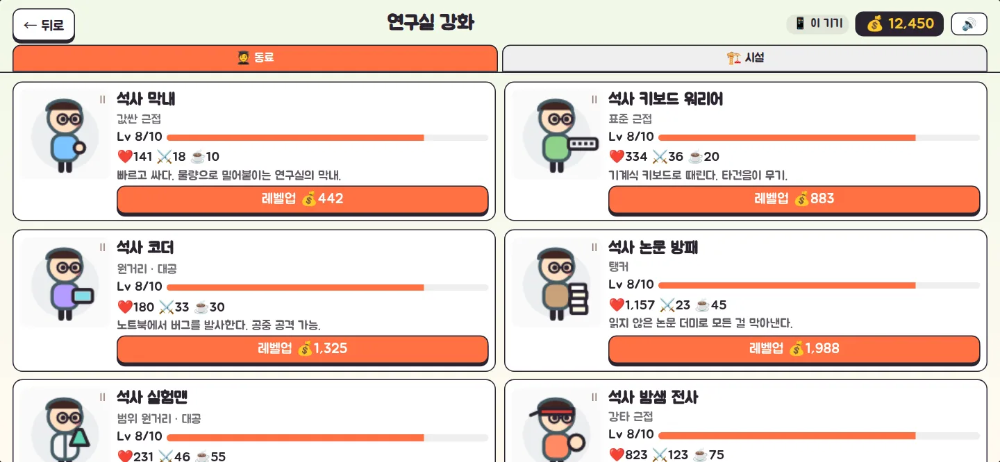
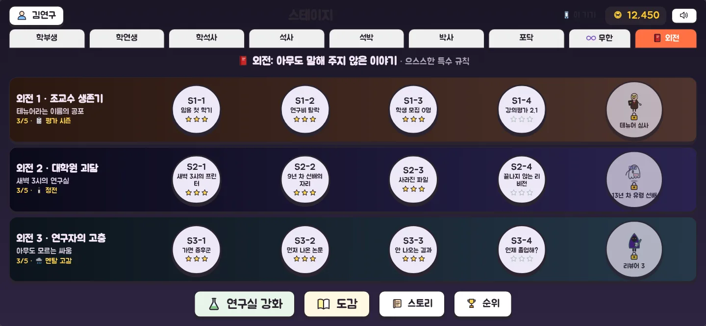
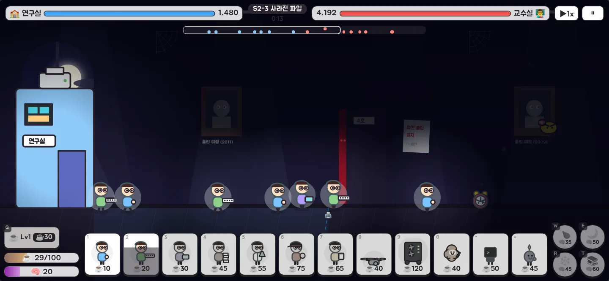
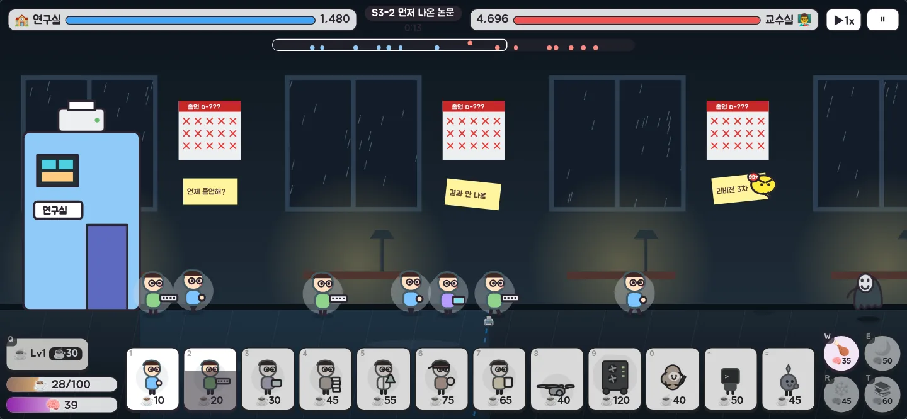

한국어 | [English](README.en.md)

<div align="center">

# 🧪 랩워즈 (Lab Wars)

**교수님의 잡무에 연구실이 무너지기 직전이다. 대학원생들이 들고일어났다.**

모바일 가로·세로 화면 어디서나 즐기는 횡스크롤 라인 디펜스 게임

[](https://apg0001.github.io/lab-wars/)

[](https://github.com/apg0001/lab-wars/actions/workflows/ci.yml)
[](https://github.com/apg0001/lab-wars/actions/workflows/pages.yml)




</div>

---

## 🎮 어떤 게임인가요?

카페인을 모아 **연구실 동료**를 내보내고, 교수님이 쏟아내는 **잡무 군단**을 밀어내 **교수실을 함락**하세요.
학부생으로 시작해 포닥까지 버티면… 마지막엔 당신도 교수가 됩니다. 그것도 *그런* 교수가.

<p align="center">
  
</p>

| | |
|:-:|:-:|
| <br>**7챕터 70스테이지** · 학부생부터 포닥까지 | <br>**스테이지마다 움직이는 스토리 컷신** |
| <br>**레벨업·진화·시설 강화** | <br>**엔딩 뒤 외전 3편** |

## ✨ 특징

### ⚔️ 전투
- **아군 12종 + 뽑기 장비 6종**: 학부 → 석사 → 박사로 *진화*하는 연구실 사람들, 연구용 드론(공중), GPU 서버(공성), AI 조수 패러디 유닛(클로디·코덱시·재미나이)
- **적 15종 + 보스 10종**: 잡무 쪽지부터 리뷰어 2, 심사위원장님, 최종 보스 **총장님**까지
- 지상/공중 공격 규칙, 범위 공격과 넉백, 처치하면 카페인 회복, 전투 중 커피머신 업그레이드
- 양쪽 자동 포탑, 멘탈을 쓰는 스킬 4종, 1x · 2x · 3x 배속
- 📦 **장비 지원 (유닛 뽑기)**: 뽑기권으로 ICT·전자 장비를 받아요 (레어 70 · 에픽 25 · 레전더리 5%, 10회 에픽 보장, 100회 천장). 화상·둔화·빙결·관통·보호막·포탑·재부팅 같은 능력을 가진 장비를 **편성 9칸**에 넣어 데려가요. 중복은 열정이 되어 레벨 상한을 올려요
- 🚨 **교수님 비상 소집**: 교수실이 밀리면 충격파와 지원군으로 반격해서, 물량만 쌓아서는 이기기 어렵습니다

### 📚 캠페인과 스토리

| 챕터 | 신분 | 보스 |
|:-:|---|---|
| 1 | 🎒 학부생: 연구실 문을 두드리다 | 랩미팅 교수님 |
| 2 | 🧑‍🔬 학연생: 인턴이라 쓰고 막내라 읽는다 | 과제 책임 교수님 |
| 3 | 📄 학석사: 통합과정의 함정 | **리뷰어 2** |
| 4 | 🎓 석사: 첫 디펜스 | 학회장님 |
| 5 | 📝 석박: 졸업논문의 계절 | 심사위원장님 |
| 6 | 🔬 박사: 끝나지 않는 과정 | 학과장님 |
| 7 | 💼 포닥: 임용의 문턱 | **총장님** |

- 🏖️ 방학, 🎤 춘·하·추·동계 학회, 📝 졸업논문 같은 **이벤트 스테이지**
- 보스를 뺀 모든 스테이지에 짧은 **스토리 컷신**이 있습니다 (걷기·점프·감정 말풍선·목소리 블립)
- 📜 스토리 다시 보기: 고른 장면부터 **몰아보기**, 보던 곳부터 **이어서 보기**
- 🎓 건너뛸 수 없는 엔딩, 그리고 처음부터 도전할 수 있는 끝없이 강해지는 **♾️ 무한 모드**와 **🏆 순위표**

### 📕 외전: 아무도 말해 주지 않은 이야기

| | |
|:-:|:-:|
| <br>**대학원 괴담**: 정전된 새벽 3시 복도 | <br>**연구자의 고충**: 비 오는 밤의 연구실 |

| 외전 | 특수 규칙 | 보스 |
|---|---|---|
| 1 · 조교수 생존기 | 📋 **평가 시즌**: 주기적으로 적이 거세진다 | 테뉴어 심사위원회 |
| 2 · 대학원 괴담 | 🕯️ **정전**: 아군 주변만 보인다. 유령은 깜빡인다 | 13년 차 유령 선배 |
| 3 · 연구자의 고충 | 🌧️ **멘탈 고갈**: 멘탈이 계속 줄고, 바닥나면 공격력 −25% | 리뷰어 3 |

### 🎨 그리고
- 🖌️ **이미지 파일 0개**: 모든 캐릭터·배경·이펙트를 Canvas로 직접 그립니다
- 🎵 **음원 파일 0개**: 배경음악 5곡과 효과음을 Web Audio로 실시간 합성합니다 (음악·효과음 따로 켜기/끄기·볼륨)
- 💥 타격감 연출: 피격 번쩍임, 히트스톱, 파편, 데미지 숫자
- ☁️ 계정 로그인으로 어느 기기에서든 이어서 플레이 (자체 서버), 게스트는 기기 내 저장
- 📲 홈 화면 설치(PWA)와 오프라인 플레이
- 💌 **심사 결과 꾸미기 뽑기**: 연구비로 논문을 투고하면 억셉트·마이너·메이저 리비전·리젝 도장과 함께 모자·옷 색·칭호가 와요. 옷장에서 주인공과 동료마다 입히면 전투·도감·컷신에 그대로 나와요 (능력치는 그대로)
- 🔄 **세로 화면 지원**: 폰을 세로로 들면 위쪽은 전장, 아래쪽은 큰 소환 버튼 격자로 바뀝니다. 전투 중에 돌려도 그대로 이어져요

## 🕹️ 조작

| 동작 | 📱 모바일 | 🖥️ 데스크톱 |
|---|---|---|
| 유닛 소환 | 하단 버튼 탭 (세로 화면은 아래쪽 큰 버튼 격자) | 클릭 또는 `1`~`9` (편성 순서) |
| 커피머신 업그레이드 | 카페인 바 위 ☕ 버튼 | `Q` |
| 스킬 | 우측 하단 버튼, 세로 화면은 소환 버튼 위 (폭격은 버튼 → 지점 탭) | `W` `E` `R` `T` (폭격은 키 → 지점 클릭) |
| 시점 이동 | 전장 좌우 드래그, 미니맵 탭 | 드래그, 휠, `←` `→` |
| 배속 | ▶1x 버튼 (1x → 2x → 3x) | 버튼 클릭 |
| 일시정지 | ⏸ | `Esc` / `P` |
| 스토리 진행 | 화면 탭 | 클릭, `Space` / `Enter` |

## 💡 공략 팁

- **공중 적**(종이비행기·알림 폭탄)은 원거리 유닛만 때릴 수 있어요. 코더나 드론을 꼭 섞으세요.
- 처치하면 카페인이 돌아와요. 초반엔 싼 유닛으로 처치를 늘리고, 커피머신(`Q`)을 일찍 올리면 편해요.
- 교수실을 한 번에 밀어붙이면 🚨 **비상 소집**에 휩쓸려요. HP 75%·50%·25% 직전엔 숨을 고르세요.
- 막히면 이미 깬 스테이지를 다시 깨서 연구비를 모으세요 (재도전 보상 50%).
- 📅 일정 관리 앱은 재소환 대기시간을, 🧘 명상 앱은 스킬 멘탈 충전을 빠르게 해 줘요.

## 🛠️ 개발

**Node.js 22 이상**이 필요합니다.

```bash
npm install
npm run dev        # 개발 서버 (같은 네트워크의 휴대폰에서도 접속 가능)
npm test           # 단위·밸런스 회귀 테스트
npm run typecheck
npm run build      # dist/ 정적 빌드

# 자동 플레이 봇으로 캠페인·외전 전체 밸런스 리포트
BALANCE_REPORT=1 npx vitest run tests/balance-report.test.ts --disable-console-intercept
```

- `main`에 병합되면 GitHub Pages로 자동 배포됩니다.
- 계정 서버 실행·API는 [docs/server.md](docs/server.md), 게임 수치와 규칙은 [docs/game-design.md](docs/game-design.md)를 보세요.

### 기술 스택

| 분야 | 사용 |
|---|---|
| 클라이언트 | TypeScript, Vite, Canvas 2D, Web Audio, DOM HUD |
| 시뮬레이션 | 고정 스텝 결정론 시뮬레이션 (시드 난수), 밸런스 봇 |
| 서버 | Node.js, SQLite, Docker |
| 테스트·배포 | Vitest, GitHub Actions, GitHub Pages, PWA |

### 구조

```
src/
  data/      유닛·적·스테이지·외전·스킬·시설 수치 (밸런스의 원본)
  sim/       렌더링과 분리된 전투 시뮬레이션, 성장 계산, 밸런스 봇
  render/    Canvas 캐릭터·배경·외전 테마·이펙트·타격감 연출
  audio/     Web Audio 합성 효과음·배경음악
  story/     스토리 대본(본편·스테이지·외전)과 애니메이션 컷신 재생기
  ui/        타이틀·지도·연구실 강화·도감·심사 결과(꾸미기)·전투 HUD (DOM)
  save/      저장소 인터페이스, 기기 내 프로필 저장, 계정 서버 동기화
server/      계정 서버 (Node + SQLite, Docker)
tests/       Vitest 테스트
docs/        기획서, 서버 문서, README 이미지
```

## 👤 만든 사람

**[박기찬](https://github.com/apg0001)** (`apg0001`): 기획·개발·밸런스, 그리고 대학원 생존.
교수님의 잡무를 직접 겪으며 만들었습니다.

## 🤝 기여

이슈·브랜치·커밋·PR 규칙은 [CONTRIBUTING.md](CONTRIBUTING.md)를 따릅니다.

<div align="center">
<sub>모든 교수님과 리뷰어 2에게 이 게임을 바칩니다. 😇</sub>
</div>
